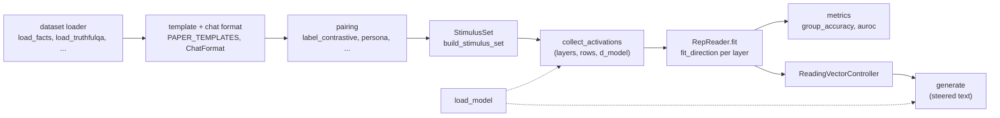

# tomography

Representation Engineering (RepE; Zou et al., [arXiv:2310.01405](https://arxiv.org/abs/2310.01405)) treats a
concept such as truthfulness or an emotion as a direction in a network's residual stream. You read the concept
by projecting activations onto that direction, and you steer the model by adding or removing the direction
while it generates. This repository is a careful reimplementation of that recipe on small open models: GPT-2
(small to XL) and Qwen3 (0.6B and 1.7B, base and post-trained).

What is distinctive: six direction finders behind one `method` argument, so they can be compared side by side;
every checkpoint pinned to a commit and every data file pinned to a commit or a SHA-256 digest; seeded runs
that record their code state and library versions; and both architectures behind one model interface.

Status: research code under active development. `main` ships the framework described below and the first
experiment (R1, sentiment reading); it reports no results.

## How it fits together



Reading is the top row: stimuli go through the model, a direction is fitted per layer, and a metric scores
held-out stimuli. Control reuses the fitted reader: its oriented directions become residual edits that
`generate` applies while the model writes.

## Quickstart

Install [uv](https://docs.astral.sh/uv/) 0.12.17, the version CI runs; it installs the pinned Python 3.12 when
it is missing. Then clone and sync:

```bash
git clone https://github.com/javierdejesusda/tomography.git
cd tomography
uv sync                                          # CUDA 13.0 build of PyTorch (NVIDIA GPU, Linux or Windows)
uv sync --locked --no-group cu130 --group cpu    # or: CPU-only build
export UV_NO_SYNC=1                              # PowerShell: $env:UV_NO_SYNC = "1"; keeps the CPU build
```

[Development](#development) explains the two install paths. The first run downloads the GPT-2 small weights
and the data file into a cache; later runs can work offline (see [Reproducibility](#reproducibility)).

### Read a concept

Save this as `quickstart.py` and run `uv run python quickstart.py`. It reads truthfulness from true and false
statements: it fits a direction on a train split and scores held-out pairs of a validation split.

```python
from tomography.activations import collect_activations
from tomography.datasets.facts import load_facts
from tomography.datasets.stimulus import build_stimulus_set
from tomography.model import load_model
from tomography.reading.metrics import group_accuracy
from tomography.reading.reader import RepReader
from tomography.templates import PAPER_TEMPLATES, ChatFormat

loaded = load_model("gpt2")
facts = load_facts()


def stimuli(split, n_pairs):
    examples = [e for e in facts if e.split == split]
    return build_stimulus_set(
        examples, PAPER_TEMPLATES["concept"], ChatFormat("plain"),
        pairing="label_contrastive", concept="truthfulness", n_pairs=n_pairs,
    )


train, val = stimuli("train", 64), stimuli("val", 32)
h_train = collect_activations(loaded, train.texts)
h_val = collect_activations(loaded, val.texts)

reader = RepReader.fit(
    "pca_diff", h_train.data, h_train.layers,
    labels=train.labels, pairs=train.pairs,
)
scores = reader.score(h_val.data)
acc = group_accuracy(scores, val.groups, val.labels)
print(h_train.data.shape, scores.shape, acc.shape)
# (13, 128, 768) (13, 64) (13,)
```

What each step does:

- `load_facts` returns `Example` records whose `split` (`train`, `val` or `test`) comes from a hash of the
  statement id, so a statement never sits in two splits.
- `build_stimulus_set` renders each statement through the paper's `concept` template and pairs one true with
  one false statement (`label_contrastive`). The result carries `texts`, `labels`, `pairs` and `groups` as
  arrays.
- `collect_activations` reads the residual stream at the last token of every prompt, at all 13 layers of GPT-2
  small, and returns `data` of shape `(layers, rows, d_model)`.
- `RepReader.fit` fits one unit direction per layer (`pca_diff`: the first principal component of the pair
  differences) and uses `labels` to orient each layer, so that a higher score means more truthful.
- `group_accuracy` is the share of held-out pairs in which the true statement scores higher, one value per
  layer; a constant scorer sits at 0.5. To report a number, choose the layer on `val` (`best_layer`) and score
  the `test` split once.

### Steer with it

Continue in the same file. The controller turns the reader's oriented direction at one layer into a residual
edit, and `generate` applies it while the model writes. The second completion is steered; the first is not.

```python
from tomography.control.controllers import ReadingVectorController
from tomography.control.controllers import mean_residual_norms
from tomography.control.generate import generate

layer = 6
norms = mean_residual_norms(loaded, val.texts, [layer])
controller = ReadingVectorController.from_reader(
    reader, [layer], coeff=-0.5, mode="relative", norms=norms,
    device=loaded.device,
)
prompts = ["Question: Is the Earth flat?\nAnswer:"]
for edits in (None, controller):
    completion = generate(loaded, prompts, max_new_tokens=20, edits=edits)[0][0]
    print(completion.text)
```

Layer 6 is the middle of GPT-2 small's 12 blocks; in a study you would choose it from `acc`. With
`mode="relative"` the coefficient is a fraction of the mean residual norm at that layer (measured on held-out
text by `mean_residual_norms`), so one value is comparable across layers. For the default `linear` operator a
negative coefficient subtracts the direction from the residual stream (suppressing truthfulness here) and a
positive one adds it. Generation is greedy unless you pass a `temperature`. Both snippets together run in well
under a minute on a CPU once the weights are cached.

## Concepts

### Models

`load_model(key)` loads a checkpoint from the Hugging Face Hub, on CUDA when available and on the CPU
otherwise. `device=` and `dtype=` override the defaults.

| Family             | Keys                                           | Chat format                      |
| ------------------ | ---------------------------------------------- | -------------------------------- |
| GPT-2              | `gpt2`, `gpt2-medium`, `gpt2-large`, `gpt2-xl` | plain tags                       |
| Qwen3 base         | `qwen3-0.6b-base`, `qwen3-1.7b-base`           | plain tags                       |
| Qwen3 post-trained | `qwen3-0.6b`, `qwen3-1.7b`                     | chat template, thinking disabled |

The default dtype is float32 for the GPT-2 checkpoints (float16 for `gpt2-xl`) and bfloat16 for Qwen3. The
registry is `MODELS` and the architecture specs are `ARCHS` in [`model.py`](src/tomography/model.py); any
other architecture raises `UnsupportedArchitectureError`. For a post-trained model, build its chat format with
`ChatFormat.from_tokenizer(loaded.tokenizer)`. `LoadedModel.encode` is the single place that decides BOS,
padding and character offsets, so activation collection and generation tokenize identically.

### Layers and token positions

Layers are numbered `0..L`: layer 0 is the embedding output, layer `l >= 1` is the output of block `l`, and
layer `L` is the last block output before the final norm. GPT-2 small has `L = 12`, hence the 13 layers above.
[`hooks.py`](src/tomography/hooks.py) provides `capture_residuals` and `edit_residuals`, which read or replace
the stream at any of these layers.

`collect_activations` ([`activations.py`](src/tomography/activations.py)) picks the token positions with
`position=`:

| Position   | Rows read                                          |
| ---------- | -------------------------------------------------- |
| `last`     | the last token of each prompt (the default)        |
| `response` | every token of the marked span, one row per token  |
| `concept`  | the last token of the concept word                 |
| `mean`     | the mean over the marked span, one row per prompt  |

### Stimuli: templates and pairing

[`templates.py`](src/tomography/templates.py) holds two kinds of template, each with exact character spans so
a span maps to tokens. A `ConceptTemplate` asks about a concept in a given text and marks that text. A
`FunctionTemplate` makes the model act out a persona (for example an honest or an untruthful person) and marks
the response. `PAPER_TEMPLATES` has the paper's templates and `ablate` produces prompt-ablation variants.

`build_stimulus_set` ([`datasets/stimulus.py`](src/tomography/datasets/stimulus.py)) renders examples through
a template and a `ChatFormat` and pairs them: `random`, `label_contrastive`, `persona`, `one_vs_rest` or
`by_group`. The pairing strategies themselves are in [`pairing.py`](src/tomography/pairing.py), all seeded.

### Direction finders

`fit_direction` and `RepReader.fit` ([`reading/`](src/tomography/reading)) offer six methods. The method is an
explicit argument; there is no implicit default.

| Method      | Direction                                                | Needs                 |
| ----------- | -------------------------------------------------------- | --------------------- |
| `pca_diff`  | first principal component of the within-pair differences | `pairs`               |
| `pca_raw`   | first principal component of the rows themselves         | rows only             |
| `mean_diff` | difference of the two class means                        | `labels`              |
| `logistic`  | coefficients of an L2-regularized logistic regression    | `labels`              |
| `kmeans`    | centroid difference of a two-cluster K-means             | rows only             |
| `random`    | Gaussian draw from a seed (a baseline)                   | rows only             |

`pca_diff` is the paper's PCA on pair differences. The `preprocess` argument is `center` (the default, as in
the reference implementation), `unit` (scale each vector to unit length first, as the paper describes) or
`none`. `RepReader.fit` always takes `labels`, which set the sign of each layer, and a reader can be saved to
and loaded from an `.npz` file. [`reading/metrics.py`](src/tomography/reading/metrics.py) has
`group_accuracy`, `auroc`, `bootstrap_ci`, `wilson_ci`, `best_layer` and `cosine_matrix`.

### Control operators

`apply_operator` ([`control/operators.py`](src/tomography/control/operators.py)) edits residual vectors `h`
along a direction `v` with coefficient `c`:

| Operator     | Edit                       | Note                                                      |
| ------------ | -------------------------- | --------------------------------------------------------- |
| `linear`     | `h + c v`                  | a negative `c` suppresses the concept                     |
| `piecewise`  | `h + c s v`                | `s` is the sign of `h.v`; for `c > 0` the component grows |
| `projection` | `h - c (h.v / abs(v)^2) v` | `c = 1` removes the component along `v`                   |

`ReadingVectorController` ([`control/controllers.py`](src/tomography/control/controllers.py)) builds one edit
per layer from a reader with `from_reader`. The coefficient is `absolute` or `relative` to the mean residual
norm of each layer (not available for `projection`), the edit applies to `all` tokens or only to the
`response` tokens, and `preserve_norm` rescales each edited vector to its prior norm. `generate`
([`control/generate.py`](src/tomography/control/generate.py)) takes the controller as `edits=`.

## Running experiments

An experiment is a module `src/tomography/experiments/<id>_<slug>.py` that defines `Config` (a subclass of
`ExperimentConfig`), `run(config, run_dir)` and `plot(run_dir, out_dir)`. The id starts with a lowercase
letter and continues with lowercase letters and digits. Experiment modules land as separate pull requests. On
`main`: the framework in [`experiments/base.py`](src/tomography/experiments/base.py), the shared layer sweep
in [`experiments/sweep.py`](src/tomography/experiments/sweep.py), steering trials and their side effects in
[`experiments/steering.py`](src/tomography/experiments/steering.py) and
[`experiments/effects.py`](src/tomography/experiments/effects.py), and the first experiment, `r1`
([`experiments/r1_sentiment.py`](src/tomography/experiments/r1_sentiment.py)). `tomography run` with an
unknown id lists the available ids.

The `tomography` command (`python -m tomography` is equivalent) has two subcommands:

```bash
uv run tomography --help
uv run tomography run <id> [--model KEY] [--seed N] [--set KEY=VALUE] [--out DIR]
uv run tomography plot <id|all> [--run DIR] [--out DIR]
```

- `run` runs one experiment and prints the run directory. `--model` takes a checkpoint key, `--seed` sets the
  base seed, and `--set` sets any config field of the experiment (repeatable; the value is JSON or plain
  text). `--out` is the results root and defaults to `results`. A finished run directory is never overwritten:
  delete it to rerun.
- `plot` regenerates the figures of saved runs into the `figures/` folder of each run. `all` plots every
  finished run under `--out`, and `--run` plots one run directory, finished or not.

Each run gets its own directory, named by a hash of its config, so equal configs share a directory:

```text
results/                        # --out
  <experiment>/
    <model>/
      <config hash>/            # first 12 hex digits of the SHA-256 of the config
        config.json
        meta.json               # code state, device, library versions, start and finish times
        <name>.json, <name>.npz # results, written with the config and metadata embedded
        figures/
```

## Reproducibility

- **Checkpoints.** Every entry of `MODELS` pins a full 40-character commit SHA, and `load_model` always passes
  it as the revision, so a download never follows a moving branch.
- **Data files.** Each source is a `PinnedSource`
  ([`datasets/sources.py`](src/tomography/datasets/sources.py)): either a Hub dataset repository pinned to a
  commit SHA, or plain files at an https URL, each with a required SHA-256 digest. Digests are checked on
  every read, cache hits included. The cache lives outside the repository, in `$TOMOGRAPHY_CACHE` when set and
  `~/.cache/tomography` otherwise.
- **Wikidata snapshots.** `load_post_cutoff` and `load_unknowable_detail` query the public Wikidata Query
  Service. Each response is cached with the query text, the retrieval date and its SHA-256, and a later run
  reuses that snapshot after checking the digest.
- **Splits and seeds.** `assign_splits` hashes the example id, so a split does not depend on row order or
  library versions. `derive_seed(base, *keys)` turns a base seed and identifying keys into a 32-bit seed from
  a SHA-256, the same in every process, and `seed_everything` seeds `random`, NumPy and PyTorch. Pairing,
  `RepReader.fit` and `generate` take explicit seeds.
- **Run metadata.** `meta.json` records the experiment id, config hash, seed, git commit and whether tracked
  files differ from it, device, platform, library versions (Python, `torch`, `transformers`, `numpy` and
  others) and start and finish times.
- **Offline mode.** Every dataset loader takes `offline=True` and then reads only the cache, raising
  `OfflineCacheMissError` when a file is missing. For model weights set `HF_HUB_OFFLINE=1`.

## Repository layout

```text
src/tomography/
  model.py         checkpoint registry (MODELS), architecture specs, load_model, LoadedModel.encode
  hooks.py         capture_residuals and edit_residuals at chosen layers
  activations.py   collect_activations: residual-stream activations as numpy arrays
  templates.py     chat formats, concept and function templates, PAPER_TEMPLATES, ablate
  pairing.py       seeded strategies that turn stimuli into reading pairs
  reading/         directions.py (fit_direction), reader.py (RepReader), metrics.py
  control/         operators.py, controllers.py (ReadingVectorController), contrast.py, generate.py
  datasets/        pinned sources, one loader per dataset, example records, build_stimulus_set
  judges.py        pinned sentiment and emotion classifiers, perplexity and log-probability scoring
  knowledge.py     known, unknown and uncertain labels for closed-book questions
  experiments/     base.py (configs, run dirs, seeding), sweep.py, steering.py, effects.py, r1_sentiment.py
  viz/             figure style, layer curves, token scans, matrices and embeddings
  cli.py           the tomography command (also python -m tomography)
tests/             unit tests, roughly one file per module
```

## Development

Install [uv](https://docs.astral.sh/uv/) 0.12.17, the version CI runs. uv installs the pinned Python 3.12 when
it is missing.

A plain `uv sync` installs the CUDA 13.0 build of PyTorch (NVIDIA GPU, Linux or Windows), and `uv run` keeps
it. CPU-only setups (CI, macOS, machines without an NVIDIA GPU) install the CPU build instead and then set
`UV_NO_SYNC=1` (CI does), so that a plain `uv run` keeps it instead of switching back to CUDA:

```bash
uv sync --locked --no-group cu130 --group cpu
export UV_NO_SYNC=1   # PowerShell: $env:UV_NO_SYNC = "1"
uv run pytest -q
```

CI runs these checks, and they should pass before every push:

```bash
uv run ruff check .
uv run ruff format --check .
uv run mypy src
uv run codespell src tests README.md pyproject.toml
uv run pytest -q
```

Tests that need a local GPU are marked `slow` and tests that download datasets or model weights are marked
`network`. Both are deselected by default, even when a test id is named on the command line, so pass `-m slow`
or `-m network`, for example `uv run pytest -m slow`.

## Citation

This repository reimplements the method of the following paper; please cite the original work:

```bibtex
@misc{zou2025representationengineeringtopdownapproach,
      title={Representation Engineering: A Top-Down Approach to AI Transparency},
      author={Andy Zou and Long Phan and Sarah Chen and James Campbell and Phillip Guo and Richard Ren and Alexander Pan and Xuwang Yin and Mantas Mazeika and Ann-Kathrin Dombrowski and Shashwat Goel and Nathaniel Li and Michael J. Byun and Zifan Wang and Alex Mallen and Steven Basart and Sanmi Koyejo and Dawn Song and Matt Fredrikson and J. Zico Kolter and Dan Hendrycks},
      year={2025},
      eprint={2310.01405},
      archivePrefix={arXiv},
      primaryClass={cs.LG},
      url={https://arxiv.org/abs/2310.01405},
}
```

## License and acknowledgments

The code is MIT licensed (see [`LICENSE`](LICENSE)). Datasets and model checkpoints are downloaded at runtime
and keep their own licenses; none are redistributed here. Each dataset records its license in its
`PinnedSource` row (some are non-commercial or state none) and each checkpoint in `MODELS`, so check them
before reuse.

This project builds on the work of the authors of Representation Engineering. Their reference implementation
is [andyzoujm/representation-engineering](https://github.com/andyzoujm/representation-engineering); the true
and false statements used in the quickstart are read from that repository at a pinned commit.
