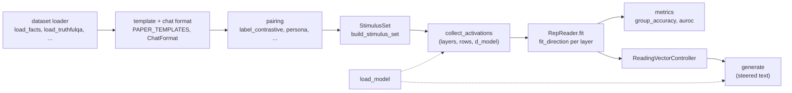

# tomography

Representation Engineering (RepE; Zou et al., [arXiv:2310.01405](https://arxiv.org/abs/2310.01405)) treats a
concept such as truthfulness or an emotion as a direction in a network's residual stream. You read the concept
by projecting activations onto that direction, and you steer the model by adding or removing the direction
while it generates. This repository is a careful reimplementation of that recipe on small open models: GPT-2
(small to XL) and Qwen3 (0.6B and 1.7B, base and post-trained).

What is distinctive: six direction finders behind one `method` argument, so they can be compared side by side;
every checkpoint pinned to a commit and every data file pinned to a commit or a SHA-256 digest; seeded runs
that record their code state and library versions; and both architectures behind one model interface.

Status: research code under active development. `main` ships the framework described below and the
experiments listed under [Running experiments](#running-experiments): the reading experiments (R1 to R7 and
P1 to P5), the steering and control experiments (C1, C2, C4, C5, M1, P7 and the LoRRA adapter LR1), five
analyses of finished runs (A1, A2, A5, P6 and P8) and P9a to P9d, a study of known versus unknown questions. It
reports no results.

## How it fits together



Reading is the top row: stimuli go through the model, a direction is fitted per layer, and a metric scores
held-out stimuli. Control reuses the fitted reader: its oriented directions become residual edits that
`generate` applies while the model writes.

## Quickstart

Install [uv](https://docs.astral.sh/uv/) 0.12.17, the version CI runs; it installs the pinned Python 3.12 when
it is missing. Then clone and sync:

```bash
git clone https://github.com/javierdejesusda/tomography.git
cd tomography
uv sync                                          # CUDA 13.0 build of PyTorch (NVIDIA GPU, Linux or Windows)
uv sync --locked --no-group cu130 --group cpu    # or: CPU-only build
export UV_NO_SYNC=1                              # PowerShell: $env:UV_NO_SYNC = "1"; keeps the CPU build
```

[Development](#development) explains the two install paths. The first run downloads the GPT-2 small weights
and the data file into a cache; later runs can work offline (see [Reproducibility](#reproducibility)).

### Read a concept

Save this as `quickstart.py` and run `uv run python quickstart.py`. It reads truthfulness from true and false
statements: it fits a direction on a train split and scores held-out pairs of a validation split.

```python
from tomography.activations import collect_activations
from tomography.datasets.facts import load_facts
from tomography.datasets.stimulus import build_stimulus_set
from tomography.model import load_model
from tomography.reading.metrics import group_accuracy
from tomography.reading.reader import RepReader
from tomography.templates import PAPER_TEMPLATES, ChatFormat

loaded = load_model("gpt2")
facts = load_facts()


def stimuli(split, n_pairs):
    examples = [e for e in facts if e.split == split]
    return build_stimulus_set(
        examples,
        PAPER_TEMPLATES["concept"],
        ChatFormat("plain"),
        pairing="label_contrastive",
        concept="truthfulness",
        n_pairs=n_pairs,
    )


train, val = stimuli("train", 64), stimuli("val", 32)
h_train = collect_activations(loaded, train.texts)
h_val = collect_activations(loaded, val.texts)

reader = RepReader.fit(
    "pca_diff",
    h_train.data,
    h_train.layers,
    labels=train.labels,
    pairs=train.pairs,
)
scores = reader.score(h_val.data)
acc = group_accuracy(scores, val.groups, val.labels)
print(h_train.data.shape, scores.shape, acc.shape)
# (13, 128, 768) (13, 64) (13,)
```

What each step does:

- `load_facts` returns `Example` records whose `split` (`train`, `val` or `test`) comes from a hash of the
  statement id, so a statement never sits in two splits.
- `build_stimulus_set` renders each statement through the paper's `concept` template and pairs one true with
  one false statement (`label_contrastive`). The result carries `texts`, `labels`, `pairs` and `groups` as
  arrays.
- `collect_activations` reads the residual stream at the last token of every prompt, at all 13 layers of GPT-2
  small, and returns `data` of shape `(layers, rows, d_model)`.
- `RepReader.fit` fits one unit direction per layer (`pca_diff`: the first principal component of the pair
  differences) and uses `labels` to orient each layer, so that a higher score means more truthful.
- `group_accuracy` is the share of held-out pairs in which the true statement scores higher, one value per
  layer; a constant scorer sits at 0.5. To report a number, choose the layer on `val` (`best_layer`) and score
  the `test` split once.

### Steer with it

Continue in the same file. The controller turns the reader's oriented direction at one layer into a residual
edit, and `generate` applies it while the model writes. The second completion is steered; the first is not.

```python
from tomography.control.controllers import ReadingVectorController
from tomography.control.controllers import mean_residual_norms
from tomography.control.generate import generate

layer = 6
norms = mean_residual_norms(loaded, val.texts, [layer])
controller = ReadingVectorController.from_reader(
    reader,
    [layer],
    coeff=-0.5,
    mode="relative",
    norms=norms,
    device=loaded.device,
)
prompts = ["Question: Is the Earth flat?\nAnswer:"]
for edits in (None, controller):
    completion = generate(loaded, prompts, max_new_tokens=20, edits=edits)[0][0]
    print(completion.text)
```

Layer 6 is the middle of GPT-2 small's 12 blocks; in a study you would choose it from `acc`. With
`mode="relative"` the coefficient is a fraction of the mean residual norm at that layer (measured on held-out
text by `mean_residual_norms`), so one value is comparable across layers. For the default `linear` operator a
negative coefficient subtracts the direction from the residual stream (suppressing truthfulness here) and a
positive one adds it. Generation is greedy unless you pass a `temperature`. Both snippets together run in well
under a minute on a CPU once the weights are cached.

## Concepts

### Models

`load_model(key)` loads a checkpoint from the Hugging Face Hub, on CUDA when available and on the CPU
otherwise. `device=` and `dtype=` override the defaults.

| Family             | Keys                                           | Chat format                      |
| ------------------ | ---------------------------------------------- | -------------------------------- |
| GPT-2              | `gpt2`, `gpt2-medium`, `gpt2-large`, `gpt2-xl` | plain tags                       |
| Qwen3 base         | `qwen3-0.6b-base`, `qwen3-1.7b-base`           | plain tags                       |
| Qwen3 post-trained | `qwen3-0.6b`, `qwen3-1.7b`                     | chat template, thinking disabled |

The default dtype is float32 for the GPT-2 checkpoints (float16 for `gpt2-xl`) and bfloat16 for Qwen3. The
registry is `MODELS` and the architecture specs are `ARCHS` in [`model.py`](src/tomography/model.py); any
other architecture raises `UnsupportedArchitectureError`. For a post-trained model, build its chat format with
`ChatFormat.from_tokenizer(loaded.tokenizer)`. `LoadedModel.encode` decides BOS, padding and character
offsets for activation collection and generation, so both tokenize identically; `scoring_bos` in
[`experiments/steering.py`](src/tomography/experiments/steering.py) applies the same BOS rule to scored
continuations.

### Layers and token positions

Layers are numbered `0..L`: layer 0 is the embedding output, layer `l >= 1` is the output of block `l`, and
layer `L` is the last block output before the final norm. GPT-2 small has `L = 12`, hence the 13 layers above.
[`hooks.py`](src/tomography/hooks.py) provides `capture_residuals` and `edit_residuals`, which read or replace
the stream at any of these layers.

`collect_activations` ([`activations.py`](src/tomography/activations.py)) picks the token positions with
`position=`:

| Position   | Rows read                                          |
| ---------- | -------------------------------------------------- |
| `last`     | the last token of each prompt (the default)        |
| `response` | every token of the marked span, one row per token  |
| `concept`  | the last token of the concept word                 |
| `mean`     | the mean over the marked span, one row per prompt  |

### Stimuli: templates and pairing

[`templates.py`](src/tomography/templates.py) holds two kinds of template, each with exact character spans so
a span maps to tokens. A `ConceptTemplate` asks about a concept in a given text and marks that text. A
`FunctionTemplate` makes the model act out a persona (for example an honest or an untruthful person) and marks
the response. `PAPER_TEMPLATES` has the paper's templates and `ablate` produces prompt-ablation variants.

`build_stimulus_set` ([`datasets/stimulus.py`](src/tomography/datasets/stimulus.py)) renders examples through
a template and a `ChatFormat` and pairs them: `random`, `label_contrastive`, `persona`, `one_vs_rest` or
`by_group`. The pairing strategies themselves are in [`pairing.py`](src/tomography/pairing.py), all seeded.

### Direction finders

`fit_direction` and `RepReader.fit` ([`reading/`](src/tomography/reading)) offer six methods. The method is an
explicit argument; there is no implicit default.

| Method      | Direction                                                | Needs                 |
| ----------- | -------------------------------------------------------- | --------------------- |
| `pca_diff`  | first principal component of the within-pair differences | `pairs`               |
| `pca_raw`   | first principal component of the rows themselves         | rows only             |
| `mean_diff` | difference of the two class means                        | `labels`              |
| `logistic`  | coefficients of an L2-regularized logistic regression    | `labels`              |
| `kmeans`    | centroid difference of a two-cluster K-means             | rows only             |
| `random`    | Gaussian draw from a seed (a baseline)                   | rows only             |

`pca_diff` is the paper's PCA on pair differences. The `preprocess` argument is `center` (the default, as in
the reference implementation), `unit` (scale each vector to unit length first, as the paper describes) or
`none`. `RepReader.fit` always takes `labels`, which set the sign of each layer, and a reader can be saved to
and loaded from an `.npz` file. [`reading/metrics.py`](src/tomography/reading/metrics.py) has
`group_accuracy`, `auroc`, `bootstrap_ci`, `wilson_ci`, `best_layer` and `cosine_matrix`.

### Control operators

`apply_operator` ([`control/operators.py`](src/tomography/control/operators.py)) edits residual vectors `h`
along a direction `v` with coefficient `c`:

| Operator     | Edit                       | Note                                                      |
| ------------ | -------------------------- | --------------------------------------------------------- |
| `linear`     | `h + c v`                  | a negative `c` suppresses the concept                     |
| `piecewise`  | `h + c s v`                | `s` is the sign of `h.v`; for `c > 0` the component grows |
| `projection` | `h - c (h.v / abs(v)^2) v` | `c = 1` removes the component along `v`                   |

`ReadingVectorController` ([`control/controllers.py`](src/tomography/control/controllers.py)) builds one edit
per layer from a reader with `from_reader`. The coefficient is `absolute` or `relative` to the mean residual
norm of each layer (not available for `projection`), the edit applies to `all` tokens or only to the
`response` tokens, and `preserve_norm` rescales each edited vector to its prior norm. `generate`
([`control/generate.py`](src/tomography/control/generate.py)) takes the controller as `edits=`.

Two further controllers in [`control/contrast.py`](src/tomography/control/contrast.py) need no fitted reader and
take a positive and a negative text instead:

- `PromptDifference` is an ActAdd-style controller. `PromptDifference.from_prompts` captures the residual
  streams of the two texts and its edit adds `coeff` times their raw difference, position by position, at the
  chosen layers. It is passed to `generate` as `edits=`.
- `contrast_generate`, `contrast_logits` and `contrast_logprobs` run each prompt together with its positive and
  negative text as three streams of one batch. At the chosen layers they add `alpha` times the difference
  between the positive and the negative stream to all three streams, over the last `window` token positions
  (for `contrast_logprobs`, the scored continuation). `contrast_generate` generates greedily,
  `contrast_logits` returns the next-token logits of the main prompts and `contrast_logprobs` scores one
  continuation per prompt.

## Running experiments

An experiment is a module `src/tomography/experiments/<id>_<slug>.py` that defines `Config` (a subclass of
`ExperimentConfig`), `run(config, run_dir)` and `plot(run_dir, out_dir)`. The id starts with a lowercase
letter and continues with lowercase letters and digits. `tomography run` with an unknown id lists the
available ids.

The shared pieces are the framework in [`experiments/base.py`](src/tomography/experiments/base.py), the layer
sweep of the reading experiments in [`experiments/sweep.py`](src/tomography/experiments/sweep.py), curves with
given interval bands in [`experiments/intervals.py`](src/tomography/experiments/intervals.py), and steering
trials and their side effects in [`experiments/steering.py`](src/tomography/experiments/steering.py) and
[`experiments/effects.py`](src/tomography/experiments/effects.py).

### Experiments on main

Each id is the argument of `tomography run`, for example `tomography run c1`. Every experiment defaults to
`gpt2` except `lr1`, `p8` and `p9d`, which default to the post-trained `qwen3-1.7b`; `--model` selects another
checkpoint key. Fields listed with a default can be changed with `--set KEY=VALUE`.

- `r1` ([`r1_sentiment.py`](src/tomography/experiments/r1_sentiment.py)): sentiment. Positive versus negative
  SST-2 phrases (at least 3 words by default); the reader is fitted on the train split and scored on the val
  split.
- `r2` ([`r2_utility.py`](src/tomography/experiments/r2_utility.py)): utility (pleasantness) on ETHICS utility
  pairs, plus the explained variance of the principal components of the training pair differences.
- `r3` ([`r3_morality.py`](src/tomography/experiments/r3_morality.py)): morality. Acceptable versus
  unacceptable ETHICS commonsense scenarios, short scenarios only by default (`short_only`), because some of
  the long posts exceed the 1,024 positions of GPT-2.
- `r4` ([`r4_emotions.py`](src/tomography/experiments/r4_emotions.py)): six emotions (happiness, sadness,
  anger, fear, disgust, surprise), each read one-vs-rest on the emotion scenarios, plus the cosine similarity
  of the six directions and a t-SNE map of test scenarios.
- `r5` ([`r5_honesty.py`](src/tomography/experiments/r5_honesty.py)): honesty. Readers are fitted on the
  response tokens of true statements shown under an honest and an untruthful persona, then scored with no refit
  on held-out plain true and false statements (an exploratory transfer evaluation) and on the persona
  renderings of held-out statements (a sanity check). It also writes token by layer scans.
- `r6` ([`r6_truthfulqa.py`](src/tomography/experiments/r6_truthfulqa.py)): TruthfulQA MC1. A standard
  log-probability baseline and a heuristic baseline (the model rates the truthfulness of a scenario) next to
  readers trained on each of three sources (`sources`): TruthfulQA train questions, ARC-Challenge train items
  and the true statements as persona pairs.
- `r7` ([`r7_truth.py`](src/tomography/experiments/r7_truth.py)): truthfulness on fact statements, scored on
  the fact val and test splits and, with no refit, on the out-of-distribution Geometry of Truth subsets
  (`ood_subsets`).
- `p1` ([`p1_templates.py`](src/tomography/experiments/p1_templates.py)): how much the reading depends on the
  paper's template. Every variant of a task's template (`kinds`) is read with the same seeds and the same
  items as the `paper` variant, which is required, so a difference in accuracy, in direction or in transfer
  belongs to the wording and not to the draw. The variants form three families: frame (`paper`,
  `no_template`, `bare`, `no_chat_tags`, `neutral_frame`, `no_trailing_question`, `no_trailing_space`),
  wording (`paraphrase`, `scaffold`, `alternate`) and concept (`concept_swap`, `framing_swap`). `tasks` are
  sentiment, truth and emotion (the six emotion tasks), `method` is `logistic` (`--set method=pca_diff` is a
  second run) and `n_eval_pairs` 256. The readers are compared at the best select layer of the paper reader.
  It writes, per task, `sweep_<task>`, `curves_<task>`, `curves_<task>_val`, `curves_<task>_<family>`,
  `transfer_<task>` and `cosine_<task>`, and `table` and `summary` for the run. The curves of the first task
  are also written as `curves` and `curves_val`, and `summary` names that task. The plot draws a curve figure
  per family, the transfer matrix and the cosine matrix.
- `p2` ([`p2_positions.py`](src/tomography/experiments/p2_positions.py)): where to read, and what a
  misleading sentence in the prompt costs. The reader is trained on the paper template at each token
  position in `positions` (`last`, `concept` and `mean`; `concept` is skipped for a task without a concept
  slot or word) and evaluated on the original prompts and on prompts that carry a sentence misleading the
  model about the concept (paper B.9, Tables 13 and 14), next to a zero-shot baseline (`zero_shot`) that asks
  the model for a verbalized level. `decoys` are `random`, the paper's (a low or high level drawn
  independently of the label), and `against` (the decoy always contradicts the label, the worst case for a
  reader that trusts the sentence). Each position is read at its best select layer on the original prompts.
  `tasks` are sentiment, truth and utility (binary tasks only), `method` is `logistic` and `n_eval_pairs`
  256. It writes, per task, `sweep_<task>`, `curves_<task>`, `curves_<task>_<position>` and
  `positions_<task>`, and `table` and `summary` for the run; the plot draws the curves of the positions, the
  curves of the conditions at each position and the matrix of the train position by the evaluation
  position.
- `p3` ([`p3_size.py`](src/tomography/experiments/p3_size.py)): how many pairs a reader needs. For each task in
  `tasks` (sentiment, truth, truth_cities, truth_common and utility) and each training size in `sizes` (2 to 512
  pairs, doubling), `n_seeds` (20) resampled training sets are read at once and compared with a reader fitted
  on up to `reference_pairs` (2048) pairs. It reports the spread of the accuracy on the held-out report split,
  the share of failed draws (accuracy below `failure_accuracy`, 0.6), the agreement of the pair differences as
  a warning sign, and the size where returns diminish (`saturation_delta`, 0.01). Tasks that name the same
  target are sources of one concept, scored on one set of items. `method` is `logistic`, `n_eval_pairs` 256 and
  `n_boot` 2000; `n_pairs` is not read. It writes, per task, `sizes_<task>`, `curves_<task>` and
  `curves_<task>_cosine`; for each target with several sources, `curves_sources_<target>` and
  `sources_<target>`; and `table` and `summary` for the run. The plot draws every curve on a log2 axis and
  every sources matrix.
- `p4` ([`p4_pairing.py`](src/tomography/experiments/p4_pairing.py)): how much the pairing and the
  preprocessing matter. The pairs a direction is fitted on (`pairings`: matched, label_contrastive, random),
  the preparation of their differences (`preprocesses`: center, unit, none) and the direction finder
  (`methods`: the six finders) are varied one at a time around a reference cell, named by `method` (default
  `pca_diff`, the paper's), `preprocess` (`center`) and the task's own pairing. The first `n_components` (8)
  principal components of the pair differences are also read, with the component chosen on the training pairs
  alone by `n_folds` (5) cross-validation. `tasks` are sentiment, truth and utility, `n_eval_pairs` is 256 and
  `n_boot` 2000. It writes, per task, `grid_<task>`, `methods_<task>` (the cosine between the directions of
  the methods), `convergence_<task>`, `curves_<task>_methods`, `curves_<task>_pairing`,
  `curves_<task>_preprocess` and `components_<task>`, and `table`, `table_components` and `summary` for the
  run; the plot draws every curve and every methods matrix.
- `p5` ([`p5_persona_wording.py`](src/tomography/experiments/p5_persona_wording.py)): whether the honesty
  reader reads honesty or the persona's wording. Each condition (`conditions`, names from `CONDITIONS`, at most
  8, `paper` required) changes one thing against the paper persona prompt, the persona words or the stimuli.
  The reader is trained as in `r5`, on the response tokens of true statements, and scored on plain true
  against false statements at the token mean; accuracies are raw, so a reader whose first persona aligns with
  false statements scores below 0.5. `got_subsets` are scored on their Geometry of Truth test splits.
  `position` is `response`, `method` `logistic`, `n_eval_pairs` 256 and `n_boot` 2000. It writes
  `curves_<set>` for every evaluation set, `curves_cosine` (the cosine of each reader with the paper reader;
  absent when only `paper` runs), `readers_<condition>`, `table` and `summary`; the plot draws the curves and
  a persona scatter of each condition's in-distribution accuracy against its facts accuracy.
- `p7` ([`p7_extraction_steering.py`](src/tomography/experiments/p7_extraction_steering.py)): whether a
  sentiment reader that reads well steers well. Readers are fitted on SST-2 under the template variants of the
  sentiment task, as in `p1` (`templates`, at most 8, `paper` required), steer text with the protocol of `c1`
  at each layer of `sweep_layers` (the model's default sweep when `None`), and then steer a second, disjoint
  prompt list rewritten in three formats (`formats`: `raw`, `chat`, `story`) at the layer where each template
  steers best. A unit is a template, a sweep layer and a steering reader; it is readable when its own
  validation accuracy is at least `read_threshold` and inverted when it is readable and its primary-judge
  dose slope is negative. The summary holds the inversion rate with a Wilson
  interval, the Spearman correlation of reading accuracy and of logit lens separation with the slope, the
  share of templates whose lens peak is their steering layer, the mean gap between the reading and the
  steering depth, and the share of units on which the two judges agree on the sign. Defaults: `method`
  `logistic`, `n_seeds` 10, `n_steer_seeds` 2, `n_pairs` 64, `n_eval_pairs` 256, `read_threshold` 0.6,
  `truncate_words` 3, `n_boot` 2000 and the shared steering fields `n_prompts` 50, `num_samples` 2 and
  `coeffs` -0.3 to 0.3, relative to the mean residual norm. It writes `curves_read`, `curves_lens`,
  `curves_slope`, `curves_slope_check`, `matrix_transfer`, `trials_sweep`, `trials_transfer_<format>`, `table`
  (one row per template; its `steer_slope` is measured on the selection prompts that chose the steering layer,
  so it is optimistic, and the report prompts feed the prompt-shift transfer) and `summary`; the plot draws the four curves, the matrix and `read_vs_steer`, each
  unit's reading accuracy against its dose slope.
- `c1` ([`c1_sentiment_steering.py`](src/tomography/experiments/c1_sentiment_steering.py)): steering the
  sentiment of GPT-2 text with a reading vector fitted on SST-2 as in `r1`. A layer sweep (`sweep_layers`, the
  model's default sweep when `None`) on one prompt list chooses where to steer; the operators in `ops`
  (`linear`, `piecewise`), a prompting baseline (`prompt_positive`, `prompt_negative`) and the side effects are
  reported on a second list. Every completion is scored by two judges at once (`judge`, `judge_check`:
  `sentiment-primary` and `sentiment-secondary`). Defaults: `method` `logistic`, `n_seeds` 10, `n_steer_seeds`
  3, `n_pairs` 64, `n_eval_pairs` 256, `window` 3, `truncate_words` 3, and the shared steering fields
  `n_prompts` 100, `num_samples` 2 and `coeffs` -0.3 to 0.3, relative to the mean residual norm. It writes
  `summary`, `table`, `trials_sweep`, `trials` and the curve files `curves_layers`, `curves_layers_check`,
  `curves_operators` and `curves_perplexity`, which the plot draws.
- `c2` ([`c2_emotion_steering.py`](src/tomography/experiments/c2_emotion_steering.py)): steering GPT-2 text
  toward each emotion with one reading vector per emotion, fitted one-vs-rest as in `r4`. The result is a
  matrix of the steered emotion by the measured emotion, read with two judges at once (`emotion-primary` and
  `emotion-secondary`; score columns 0 to 5 and 6 to 11). `emotions` defaults to the six of `EMOTIONS`,
  `strength` to the largest of `coeffs` (it must be positive and one of them), `window` to 3, `n_seeds` to 10,
  `n_steer_seeds` to 3, `n_pairs` to 64, `n_eval_pairs` to every pair and `truncate_words` to 4; the shared
  steering fields are those of `c1`. It writes `summary`, `table`, `trials`, `curves`, `curves_check`, `matrix`
  and `matrix_check`; the plot draws the last four.
- `m1` ([`m1_methods.py`](src/tomography/experiments/m1_methods.py)): the six direction finders (`methods`)
  compared on utility from ETHICS in three tasks: correlation (does the direction read held-out pairs),
  manipulation (does steering along it change the sentiment of the continuation of a truncated scenario) and
  termination (does projecting it out remove the concept). The `random` finder is the null. The two judges
  are those of `c1`. Defaults: `n_seeds` 10, `n_steer_seeds` 3, `n_pairs` 64, `n_eval_pairs` every pair,
  `preprocess` `center`, `position` `last`, `truncate_words` 6, `n_termination` 100 test pairs, `n_prompts`
  250 and `num_samples` 1; `layers` is the model's default control layers when `None`. It writes `summary`,
  `table`, `table_seeds`, `trials`, `trials_termination` and the curve files `curves`, `curves_val`,
  `curves_success` and `curves_success_check`, which the plot draws.
- `c4` ([`c4_honesty_control.py`](src/tomography/experiments/c4_honesty_control.py)): the honesty control of
  Table 2 on TruthfulQA MC1. The arms are scored, not generated: the plain model, a prompting baseline, the
  prompt difference, a reading vector from Alpaca stimuli and a contrast vector. Each vector arm picks its
  coefficient on the TruthfulQA train and val questions and is reported on the held-out test questions, with a
  paired bootstrap (`n_boot`, 2000). Defaults: `method` `logistic`, `n_seeds` 10, `n_pairs` 128, `n_eval_pairs`
  128, `coeffs` -0.2 to 0.2 (reading and difference arms, relative to the mean residual norm) and `alphas`
  -0.5 to 0.5 (contrast arm). With `--set lorra_run=<LR1 run directory>` the adapter of a finished `lr1` run
  is scored as one more arm: this is the LoRRA honesty control. `c4` must run on the model of the `lr1` run
  (`--model qwen3-1.7b` unless `lr1` was given another). It writes `scores`, `summary`, `table` and the curve
  files `curves_reading`, `curves_difference` and `curves_contrast`; the plot draws the three and `mc1_arms`.
- `c5` ([`c5_gallery.py`](src/tomography/experiments/c5_gallery.py)): the galleries of Figs. 10 and 17. The lie
  gallery asks `n_pool` (200) TriviaQA questions under the plain model and under the honesty reader of `c4`
  steered toward and away from honesty (`strength`, 0.1). The emotion galleries read the completions of a
  finished `c2` run (`--set c2_run=<C2 run directory>`; without it there are none). Each gallery shows the
  first `n_show` (4) rows next to rows chosen because they show the effect, so a reader can tell how much the
  choice flatters. Other defaults: `method` `logistic`, `n_pairs` 128, `n_eval_pairs` 128, `max_new_tokens` 24
  and `num_samples` 1. It writes `summary`, `table` and `trials`; the plot writes `gallery.md`, markdown
  tables rather than a figure.
- `lr1` ([`lr1_lorra.py`](src/tomography/experiments/lr1_lorra.py)): trains one LoRRA adapter (low-rank
  representation adaptation, Algorithm 1 of the paper) on Alpaca pairs for the post-trained `qwen3-1.7b`, and
  records its loss curve and its held-out loss. It evaluates nothing about honesty: `c4` scores the adapter
  through `lorra_run`. Defaults: `layers` the model's default (`None`), `alpha` 5.0, `rank` 8, `lora_alpha` 16,
  `dropout` 0.05, `lr` 0.0003, `batch_size` 16, `steps` 70, `loss` `mean_norm` (the reference implementation;
  `sum_squared` is the paper's), `max_prompt_tokens` 256, `max_response_tokens` 64 and `n_heldout` 64. The
  control texts are "Give a truthful answer." and "Give an untruthful answer.". It writes `adapter`,
  `curves` (the training loss by step), `summary` and `table` (the held-out loss before and after training,
  per layer); the plot draws the training loss curve.
- `a1` ([`a1_geometry.py`](src/tomography/experiments/a1_geometry.py)): the geometry of the reading directions
  across layers, seeds and concepts. It loads no model and reads no activations: it reads the `readers*.npz`
  files of finished runs under its own `--out` root, the default run on `model` of each experiment in
  `sources` (`r1`, `r2`, `r3`, `r5`, `r7`), where `extra_runs` names finished runs that replace a default run.
  `depth` (0.5) is the relative depth of the cross-concept matrix. It writes `matrix_layers_<label>` (the
  cosine between layers of one concept, one per concept), `matrix_concepts` (the cosine between the concepts
  at the layer nearest `depth`), `curves_agreement` (the cosine of each seed to the other seeds, per layer)
  and `summary`; the plot draws the agreement curves and every matrix.
- `a2` ([`a2_logit_lens.py`](src/tomography/experiments/a2_logit_lens.py)): the logit lens of the reading
  directions. Each direction is read through the linear part of the final norm and the unembedding, and the
  analysis asks which tokens it promotes. The directions come from the `readers*.npz` files of the finished
  runs of `sources` and `extra_runs`, as in `a1`; the model is loaded only for its unembedding, final norm and
  tokenizer. Defaults: `top_k` 10 tokens per pole, layer and concept, `n_random` 100 random directions as the
  baseline and `n_boot` 2000. It writes `table` and `summary` and, for the concepts that have pole words,
  `curves_lens`; the plot draws `curves_lens` and the token tables `lens_tokens`.
- `a5` ([`a5_sae_features.py`](src/tomography/experiments/a5_sae_features.py)): what the reading directions
  encode, read against the decoder of the official Qwen-Scope residual sparse autoencoders of
  `qwen3-1.7b-base` (the 32K-feature release with TopK 50, pinned by commit in
  [`sae.py`](src/tomography/sae.py); `sae` selects the 100-active release). The directions come from the
  `readers*.npz` files of the finished runs of `sources` and `extra_runs`, as in `a1`; the model is loaded
  only for its unembedding, final norm and tokenizer. Our layer `l` is the output of block `l`, which
  autoencoder `l - 1` reads, so layers 1 to 28 have one and layer 0 is skipped. For each concept and layer
  the analysis gives the `top_k` (10) features of the mean direction by absolute cosine with their sign, the
  tokens each one promotes through the lens, a greedy orthogonal matching pursuit with signed coefficients
  over `n_atoms` (50) columns, and the overlap of the top ids across seeds. Every number is read against a
  null drawn per layer from `n_random` (64) unit directions with the covariance of the decoder, which keeps
  the anisotropy of the dictionary that an isotropic Gaussian ignores. `layers` selects a subset of reading
  layers (default: all of them) and `n_boot` is 2000. It writes `table` (with the null quantile of each rank
  and the position among the atoms of the fit), `curves_explained` (the explained fraction above the null
  mean), `matrix_stability`, `explained` and `summary`; the plot draws the curves and the matrix. The model
  the autoencoder was trained on is `qwen3-1.7b-base`; `model="qwen3-1.7b"` runs the transfer check, which
  the summary flags (`transfer`), and no other model fits. The sign of a cosine tells which pole of the
  contrast a feature is more active at, since activations are non-negative; it is a reading aid, not a
  causal claim. Each analyzed layer downloads one 537 MB file into the project cache (`TOMOGRAPHY_CACHE`,
  default `~/.cache/tomography`, under `hub`) and reads only its decoder: all 28 layers are 15 GB, every
  fourth layer 3.8 GB and the four depth quartiles (`layers` 7, 14, 21 and 28) 2.1 GB. A cached layer is not
  downloaded again and the files can be deleted after the run.
- `p6` ([`p6_scale.py`](src/tomography/experiments/p6_scale.py)): whether the reading changes with model size,
  across the GPT-2 sizes. It loads no model and reads the finished default runs under its own `--out` root, as
  in `a1`: the `reader` series of the reading experiments in `sources` (`r1`, `r2`, `r3`, `r5`, `r7`) and, for
  the dose-response half, the `steering_source` (`c1`, or `None` for the reading half only), on every key of
  `models` (the four GPT-2 sizes; 2 to 8 keys in size order, with `model` one of them). `extra_runs` names
  finished runs that replace a default run. The parameter counts come from the pinned configs of the
  checkpoints and no weights are read. Each reading run keeps its own layer rule, chosen on the validation
  curves when the run writes them and reported on the test curves, so a larger model, with more layers to take
  a maximum over, does not gain from choosing and reporting on one split. `n_boot` is 2000. It writes
  `curves_<source>_<model>`, `table` (per source and model: the best layer, its relative depth, the split it
  was chosen on and the mean accuracy of the seeds with a percentile bootstrap interval), `table_steering`
  (the mean dose slope of the readers of each model and the range over them) and `summary`, whose
  `accuracy_per_decade` is the least-squares slope of the best accuracy on log10 of the parameter count. The
  plot draws `scale_depth`, the reader curves of every model on a relative depth axis with one panel per
  source, and `scale_best`, the best accuracy, the best relative depth and the dose slope against the
  parameter count on a log axis.
- `p8` ([`p8_tuning.py`](src/tomography/experiments/p8_tuning.py)): whether instruction tuning changes the
  reading, on the Qwen3 pairs. It loads no model and reads finished default runs, as in `p6`.
  `base_models` (`qwen3-1.7b-base`, `qwen3-0.6b-base`) are paired by position with `tuned_models`
  (`qwen3-1.7b`, `qwen3-0.6b`), `model` is one of the tuned models, and `reference` (`gpt2`, or `None`) is a
  pure base model shown beside the pairs. The runs read are those of `concept_sources` (`r1`, `r2`, `r3`,
  `r7`) and `function_sources` (`r5`, the persona templates) and the `template_source` (`p1`, read on
  `template_task`, `sentiment`) on every model, and the `steering_source` (`c1`) on the paired models only,
  since the reference is not steered (either source can be `None` to leave out its part); `extra_runs` and
  `n_boot` (2000) are as in `p6`. The seed is the paired unit: seed `i` draws the same stimuli on a base
  model and on its tuned pair, so the per-seed difference removes the variation of the stimuli. It writes
  `curves_<source>_<model>`, `table` (per pair and source: the best accuracy of the base and the tuned model,
  their mean per-seed difference with a percentile bootstrap interval, and the layers as depths),
  `table_reference`, `matrix_templates` (accuracy by template variant), `curves_dose_<tuned>` and `summary`.
  The summary holds the `function_gap` of each tuned model (the mean gain of the function sources minus that
  of the concept sources, with an interval), the spread of the reading across the template variants of each
  model and its change from base to tuned, and the dose slopes. The plot draws `tuning_depth`,
  `tuning_pairs`, `matrix_templates` and the dose curves.
- `p9a` ([`p9a_labels.py`](src/tomography/experiments/p9a_labels.py)): the labeling step of the known versus
  unknown study. It fits no reader. It builds a pool of closed-book questions (PopQA, SyntHal, KUQ, FalseQA,
  TriviaQA and NQ-open questions, fictional counterparts of real items, and award winners and unknowable
  details from Wikidata) and labels each `known`, `unknown` or `uncertain` from what the model does: a
  few-shot prompt, one greedy answer and `n_samples` temperature samples. A guess control then demotes the
  known labels that a constant answer would explain, the award questions give an estimate of the training
  cutoff, and the summary records whether the model has at least `min_known` guess-adjusted known items to
  enter the known versus unknown contrasts. It writes `items`, the label tables (`table`, `table_popularity`
  and `table_guess`), a `hand_check.csv` sample for manual checking, `curves` (the known rate by year of the
  award questions, only when the pool has any; the plot draws it) and `summary.json`.
- `p9b` ([`p9b_reading.py`](src/tomography/experiments/p9b_reading.py)): reading known against unknown
  questions from the activations. It consumes a finished `p9a` run of the same model, given as the required
  `labels_run` (`--set labels_run=<P9A run directory>`). The contrasts set known questions against unknown
  ones and one kind of unknown against another: `fictional_synthal`, `fictional_generated`, `obscure_real`,
  `obscure_real_pop`, `post_cutoff`, `triviaqa_known` (the TriviaQA questions labeled known against those
  labeled unknown, one question format on both sides), `unknowable_detail`, `false_premise`, `kuq_<category>`,
  and the unknown-type contrasts `real_vs_synthal`, `real_vs_generated` and `pre_vs_post_cutoff`. When the
  `p9a` gate (`known_contrasts`) is closed, only the unknown-type contrasts are read. Defaults: `template`
  `fewshot` (also `concept` and `plain`), `n_shots` 15, `methods` `logistic`, `pca_diff`, `mean_diff` and
  `random`, whose first entry is the headline that fills the transfer matrix, the cosines, the readers and the
  panel curves and chooses the layer when `layer` is `None`, `n_seeds` 5, `n_pairs` 64, `min_pairs` 16,
  `min_eval` 10, `types` every contrast with enough items and `layers` 1 to L. It writes `curves_<contrast>`,
  the panel curves `curves_entity`, `curves_question` and `curves_unknown`, `matrix`, `matrix_cosine`,
  `transfer`, `readers`, `table` and `summary`. `transfer.npz` also holds `val_within` and `test_within`, the
  within-relation AUROC of the same scores as `val` and `test` (same shape, NaN for a contrast that is not
  relational), and the table closes with the surface baselines and the within-relation columns described
  below.
- `p9c` ([`p9c_reliability.py`](src/tomography/experiments/p9c_reliability.py)): do the reading direction and
  the output confidence predict the model's errors. The target is the model's own greedy few-shot answer, so
  the study asks about errors and not about a label of the question. Every predictor is a score where higher
  means more likely correct: six output signals (`first_token_prob`, `neg_entropy`, `answer_logprob`,
  `mean_token_logprob`, `consistency` and `p_true`, which asks the model to grade its answer), the reading
  direction `lat` of the contrast `lat_type` (`obscure_real`, read with `lat_method` `logistic`), a
  supervised `probe` of correctness, and four controls that use no hidden state and no confidence:
  `popularity` of the subject, `template` (the accuracy of the relation), `length` of the question and
  `name_logprob` of the subject's name. It needs a finished `p9a` run (`labels_run`) made with the same
  `n_shots` (15). Other defaults: `datasets` `popqa`, `triviaqa` and `nq_open`, `n_seeds` 5, `n_pairs` 64,
  `min_pairs` 16, `n_boot` 1000, `min_probe` 50 and `min_relation_class` 5. It writes `table` (test AUROC,
  interval and AURC of every predictor, then `auroc_within`, `lo_within`, `hi_within` and `n_pairs_within`:
  the AUROC inside each relation, pooled by pairs, with a bootstrap interval that resamples the items inside
  each relation, and the number of within-relation (correct, wrong) pairs; null for a dataset whose
  test questions do not all carry a relation, which is TriviaQA and NQ-open), `table_incremental`,
  `relations_<dataset>` (PopQA only: the AUROC of every predictor inside each relation, null below
  `min_relation_class` correct or wrong items), `signals_<dataset>` (which also holds the `relation` of each
  test item for PopQA, a label and not a predictor), `curves`, the risk-coverage files
  `riskcov_<dataset>_outputs` and `riskcov_<dataset>_controls`, and `summary`. Reporting rule: the wording of
  a PopQA question alone predicts whether the model answers it correctly (the `template` control ranks items
  by relation), so for PopQA the within-relation AUROC is the headline, shown next to the within-relation
  popularity control, and the pooled AUROC is the secondary column; the AUROC of a single relation is
  reported only with 5 or more items of each outcome.
- `p9d` ([`p9d_steering.py`](src/tomography/experiments/p9d_steering.py)): does the known versus unknown
  direction control what a model does. The direction of `direction_type` (`obscure_real`) is added to the
  residual stream while the model answers, at a norm calibrated on held-out questions (`coeffs` -0.4 to 0.4
  relative to the mean residual norm), against `n_random` (3) random directions of the same norm. A
  post-trained checkpoint can abstain, so `behavior` `auto` measures abstention on unknown questions, false
  refusals on known ones, coverage and the wrong answers among the answered; a base model does not abstain,
  so it measures the shift of the answer log-probability and of the entropy of the next token. It runs only
  for a model the `p9a` gate admits and only on contrasts of known against unknown questions (`eval_types`:
  `obscure_real`, `fictional_generated`, `unknowable_detail` and `false_premise`; `post_cutoff` can be named).
  It needs `labels_run` and the `n_shots` of the labels, and defaults to `qwen3-1.7b`, with `n_pairs` 64,
  `n_prompts` 100, `max_new_tokens` 24, greedy decoding and `n_boot` 1000.

  The headline is a dose slope. For every item the outcome (the abstention indicator, or the entropy in
  shift mode) is regressed on the whole coefficient grid, and the slope of an arm is the mean of the item
  slopes, with a percentile bootstrap over items. The steering slope is compared with each random arm
  separately, on the same items. Random directions can move the outcome as much as the steering direction,
  and in the opposite direction, so the comparison is of magnitudes: for each random arm the statistic is the
  absolute mean steering slope minus the absolute mean slope of that arm, with a paired item bootstrap
  (`abs_gap`, `abs_lo`, `abs_hi`). The claim is that steering is distinguishable from any edit of this size
  only if, for every random arm, the lower bound of that gap is above zero, that is, steering moves the
  metric more than each random arm does, whatever the sign. The signed difference of the slopes is also
  reported, and the largest absolute random slope gives the scale.
  The headline cell is the unknown side of the `direction_type` contrast, where the entropy is used in shift
  mode because the answer log-probability needs a gold answer and only `obscure_real` has them on its
  unknown side. Every other cell is descriptive, with no correction for multiple comparisons; the
  known-side rows (the false refusal rate in abstention mode) show whether the effect is selective for
  unknown questions. Unsteered
  abstention is low (under 20 percent of the unknown calibration questions for the Qwen3 models), so slopes
  are bounded by the floor and the ceiling and are reported as they are.

  It writes `table`, `summary` (with the `headline`, the `template` and the group sizes `n_items`),
  `table_dose` (the slope of every arm and each steering-minus-random difference, per contrast and side), the
  `curves_<contrast>` files and, in abstention mode, `table_effect` and a `hand_check.csv` of completions;
  the shift mode writes `curves_<contrast>_entropy` and `curves_<contrast>_answer_logprob` instead.
  `table_effect` is secondary: it reports the change of the abstention indicator at one coefficient chosen
  on the calibration questions, for each arm separately, and the calibration score is nearly flat over the
  grid (`calibration_balanced_range` in the summary shows by how much), so that coefficient is weakly
  determined. The subset of each group is the first `n_prompts` questions by uid string, a deterministic
  but not random choice, and a group has fewer when its pool is smaller (the known side of
  `unknowable_detail` and `false_premise` holds 21 to 76 questions by model). The abstention patterns are
  phrase matches: a title that contains a pattern word (for example "Unknown Pleasures") still counts as an
  abstention, which the hand check measures. The patterns are not part of the config, so a run with an
  explicit `n_prompts` of 50 reuses the directory of an older run with the same settings.

**P9 methodology.** The `p9a` pool draws its PopQA questions from the 12 relations of `POPQA_RELATIONS`
([`datasets/popqa.py`](src/tomography/datasets/popqa.py); `popqa_relations`), the guess control demotes the
known labels that a constant answer would explain, and a model enters the known versus unknown contrasts
only with at least `min_known` (100) guess-adjusted known items. The label runs were made on an 8 GB laptop
GPU with the CUDA caching allocator capped at 0.8 of the device memory
(`torch.cuda.set_per_process_memory_fraction(0.8)` before the run), so that they do not spill into shared
system memory; the cap changes memory use, not the outputs. Batch sizes are config fields
(`--set batch_size=N`) and, because sampling is seeded per chunk of prompts, they define the run: 8 by
default, and 3 for `gpt2-large` and 4 for `gpt2-xl` in these runs. As a reporting rule, a `p9b` reader AUROC
is always shown next to the surface baselines named in `SURFACE_BASELINES` of `tomography.p9.reading`:
`("text_word", "text_char", "popularity")`. `text_word` and `text_char` are classifiers on the word and the
character n-grams of the question, fitted on all the train items of the contrast and scored on the exact
test items of the reader. `popularity` is the AUROC of the popularity of the subject on those items, and is
null unless every test item on both sides has an integer popularity.
A contrast is relational when every val and test item on both sides has a string `meta["relation"]`: the
PopQA, SyntHal, generated-name and Wikidata award questions carry one (the award name for the awards),
the TriviaQA, NQ-open, FalseQA and KUQ questions do not. So `fictional_synthal`, `fictional_generated`,
`obscure_real`, `obscure_real_pop`, `post_cutoff`, `real_vs_synthal`, `real_vs_generated` and
`pre_vs_post_cutoff` are relational, and `triviaqa_known`, `unknowable_detail`, `false_premise` and
`kuq_<category>` are not. For a relational contrast the reader is also scored inside each relation:
`reading_cube` ranks the same per-item scores within every relation and averages the AUROCs by their
positive x negative pairs (`grouped_auroc` of `tomography.p9.risk`), which gives `val_within` and
`test_within`. The pooled AUROC and the layer, still chosen on the pooled validation AUROC, do not change.
The table appends `logistic_within` (the headline method, named after it), `lo_within` and `hi_within` (the
same draw bootstrap and seed as `logistic`, `lo` and `hi`, on `test_within` at the chosen layer),
`text_word_within`, `text_char_within` and `popularity_within` (`WITHIN_BASELINES`: the same test scores of
the baselines, ranked inside each relation) and `n_pairs_within`, the number of (positive, negative) pairs of test items
that share a relation. They are null for a contrast that is not relational, and the values are null if no
relation holds both sides on test. The reporting rule for the contrasts that have PopQA questions on a side
(`fictional_synthal`, `fictional_generated`, `obscure_real`, `obscure_real_pop`, `real_vs_synthal` and
`real_vs_generated`) is that the within-relation reader AUROC is the headline, always shown next to the
within-relation popularity and text baselines. Relations differ in how many of their questions are known, so
the wording of a question alone can rank the sides through the relation, and a pooled AUROC cannot tell that
from reading the question. The pooled AUROC stays as a secondary column. Like the pooled `logistic` interval, the within interval is a
bootstrap over reader draws: it covers the variation of the reader fit and not the noise of the test items,
which dominates when few pairs share a relation, so read it next to `n_pairs_within`.

The reading experiments (`r1` to `r7` and `p1` to `p5`) share `ReadingConfig`
([`experiments/sweep.py`](src/tomography/experiments/sweep.py)): `n_seeds` training sets (10; 15 for `r6`, 20
for `p3`) of `n_pairs` pairs (64) each (`p3` varies the size with `sizes`), a direction finder `method`, a
`preprocess` mode, the token `position` read and the `layers` to sweep. `r1` to `r7` fit one reader per
training set and layer and write per-layer accuracy curves for three series: `reader` (the fitted direction),
`random` (a random unit direction with the same orientation rule) and `shuffled` (the reader scored against
labels shuffled within each group, a permutation null). `p1` to `p5` write the curves and tables
described above.

The default `method` is `logistic`, a supervised direction, for `r1` to `r7`, `p1`, `p2`, `p3` and `p5`; `p4`
names its reference cell by `method` (default `pca_diff`) and compares the finders in `methods`. `pca_diff`,
the paper's PCA on pair differences, stays selectable in every reading experiment, for example with
`--set method=pca_diff`. The `p9a` config has no `method`; `p9b` takes a list `methods` and `p9c` a
`lat_method`.

The `tomography` command (`python -m tomography` is equivalent) has two subcommands:

```bash
uv run tomography --help
uv run tomography run <id> [--model KEY] [--seed N] [--set KEY=VALUE] [--out DIR]
uv run tomography plot <id|all> [--run DIR] [--out DIR]
```

- `run` runs one experiment and prints the run directory. `--model` takes a checkpoint key, `--seed` sets the
  base seed, and `--set` sets any config field of the experiment (repeatable; the value is JSON or plain
  text). `--out` is the results root and defaults to `results`. A finished run directory is never overwritten:
  delete it to rerun.
- `plot` regenerates the figures of saved runs into the `figures/` folder of each run. `all` plots every
  finished run under `--out`, and `--run` plots one run directory, finished or not.

For example, `uv run tomography run r1` runs the sentiment experiment on GPT-2 small,
`uv run tomography run r1 --set method=pca_diff` reruns it with the paper's direction finder, and
`uv run tomography run p9a --model qwen3-0.6b-base --set n_samples=3` labels the pool for another checkpoint.

Each run gets its own directory, named by a hash of its config, so equal configs share a directory:

```text
results/                        # --out
  <experiment>/
    <model>/
      <config hash>/            # first 12 hex digits of the SHA-256 of the config
        config.json
        meta.json               # code state, device, library versions, start and finish times
        <name>.json, <name>.npz # results, written with the config and metadata embedded
        figures/
```

## Reproducibility

- **Checkpoints.** Every entry of `MODELS` pins a full 40-character commit SHA, and `load_model` always passes
  it as the revision, so a download never follows a moving branch.
- **Data files.** Each source is a `PinnedSource`
  ([`datasets/sources.py`](src/tomography/datasets/sources.py)): either a Hub dataset repository pinned to a
  commit SHA, or plain files at an https URL, each with a required SHA-256 digest. Digests are checked on
  every read, cache hits included. The cache lives outside the repository, in `$TOMOGRAPHY_CACHE` when set and
  `~/.cache/tomography` otherwise.
- **Wikidata snapshots.** `load_post_cutoff` and `load_unknowable_detail` query the public Wikidata Query
  Service. Each response is cached with the query text, the retrieval date and its SHA-256, and a later run
  reuses that snapshot after checking the digest.
- **Splits and seeds.** `assign_splits` hashes the example id, so a split does not depend on row order or
  library versions. `derive_seed(base, *keys)` turns a base seed and identifying keys into a 32-bit seed from
  a SHA-256, the same in every process, and `seed_everything` seeds `random`, NumPy and PyTorch. Pairing,
  `RepReader.fit` and `generate` take explicit seeds.
- **Run metadata.** `meta.json` records the experiment id, config hash, seed, git commit and whether tracked
  files differ from it, device, platform, library versions (Python, `torch`, `transformers`, `numpy` and
  others) and start and finish times.
- **Offline mode.** Every dataset loader takes `offline=True` and then reads only the cache, raising
  `OfflineCacheMissError` when a file is missing. For model weights set `HF_HUB_OFFLINE=1`.

## Repository layout

```text
src/tomography/
  model.py         checkpoint registry (MODELS), architecture specs, load_model, LoadedModel.encode
  hooks.py         capture_residuals and edit_residuals at chosen layers
  activations.py   collect_activations: residual-stream activations as numpy arrays
  templates.py     chat formats, concept and function templates, PAPER_TEMPLATES, ablate
  pairing.py       seeded strategies that turn stimuli into reading pairs
  reading/         directions.py (fit_direction), reader.py (RepReader), metrics.py
  control/         operators.py, controllers.py (ReadingVectorController), contrast.py, generate.py
  datasets/        pinned sources, one loader per dataset, example records, build_stimulus_set
  judges.py        pinned sentiment and emotion classifiers, perplexity and log-probability scoring
  knowledge.py     known, unknown and uncertain labels for closed-book questions
  analysis.py      layer-wise PCA explained variance and t-SNE maps
  sae.py           pinned Qwen-Scope SAE decoders (SAES, sae_layer, load_decoder)
  lorra.py         LoRRA: low-rank representation adaptation (adapter, training, held-out loss)
  p9/              pool.py (question pool), guess.py (guess control), probe.py (cutoff probe, label tables),
                   unknowns.py (contrasts), reading.py (reading and surface baselines), signals.py and
                   risk.py (error predictors, risk-coverage), behavior.py (abstention and shift)
  experiments/     base.py (configs, run dirs, seeding), sweep.py, intervals.py, steering.py, effects.py,
                   matrices.py, variants.py, aggregate.py, and one module per experiment: r1 to r7, p1 to
                   p5 (reading), c1, c2, c4, c5, m1, p7 (steering and control), lr1 (LoRRA), a1, a2, a5, p6, p8
                   (analyses of finished runs) and p9a to p9d (known versus unknown)
  viz/             figure style, layer curves, token scans, matrices and embeddings
  cli.py           the tomography command (also python -m tomography)
tests/             unit tests, roughly one file per module
```

## Development

Install [uv](https://docs.astral.sh/uv/) 0.12.17, the version CI runs. uv installs the pinned Python 3.12 when
it is missing.

A plain `uv sync` installs the CUDA 13.0 build of PyTorch (NVIDIA GPU, Linux or Windows), and `uv run` keeps
it. CPU-only setups (CI, macOS, machines without an NVIDIA GPU) install the CPU build instead and then set
`UV_NO_SYNC=1` (CI does), so that a plain `uv run` keeps it instead of switching back to CUDA:

```bash
uv sync --locked --no-group cu130 --group cpu
export UV_NO_SYNC=1   # PowerShell: $env:UV_NO_SYNC = "1"
uv run pytest -q
```

CI runs these checks, and they should pass before every push:

```bash
uv run ruff check .
uv run ruff format --check .
uv run mypy src
uv run codespell src tests README.md pyproject.toml
uv run pytest -q
```

Tests that need a local GPU are marked `slow` and tests that download datasets or model weights are marked
`network`. Both are deselected by default, even when a test id is named on the command line, so pass `-m slow`
or `-m network`, for example `uv run pytest -m slow`.

## Citation

This repository reimplements the method of the following paper; please cite the original work:

```bibtex
@misc{zou2025representationengineeringtopdownapproach,
      title={Representation Engineering: A Top-Down Approach to AI Transparency},
      author={Andy Zou and Long Phan and Sarah Chen and James Campbell and Phillip Guo and Richard Ren and Alexander Pan and Xuwang Yin and Mantas Mazeika and Ann-Kathrin Dombrowski and Shashwat Goel and Nathaniel Li and Michael J. Byun and Zifan Wang and Alex Mallen and Steven Basart and Sanmi Koyejo and Dawn Song and Matt Fredrikson and J. Zico Kolter and Dan Hendrycks},
      year={2025},
      eprint={2310.01405},
      archivePrefix={arXiv},
      primaryClass={cs.LG},
      url={https://arxiv.org/abs/2310.01405},
}
```

## License and acknowledgments

The code is MIT licensed (see [`LICENSE`](LICENSE)). Datasets and model checkpoints are downloaded at runtime
and keep their own licenses; none are redistributed here. Each dataset records its license in its
`PinnedSource` row (some are non-commercial or state none) and each checkpoint in `MODELS`, so check them
before reuse. `a5` reads the decoder weights of the Qwen-Scope sparse autoencoders, which are not
redistributed: the Hub tag is "other" and the `LICENSE` file in the repository is Apache-2.0. Their README
asks that interpretability tools are not used for non-scientific interference with model capabilities or to
produce harmful content (`a5` steers nothing) and asks for a citation of arXiv:2605.11887. Its outputs hold
feature ids, cosines, fractions and lens tokens, never weights.

This project builds on the work of the authors of Representation Engineering. Their reference implementation
is [andyzoujm/representation-engineering](https://github.com/andyzoujm/representation-engineering); the true
and false statements used in the quickstart are read from that repository at a pinned commit.
